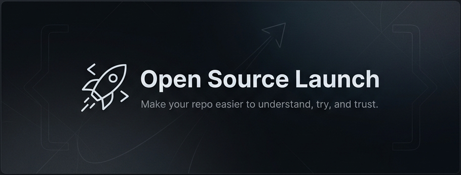

# Open Source Launch Skill

**Make an open-source repo easier to understand, easier to try, and easier to trust before you launch it.**



[](./LICENSE)
[](https://docs.claude.com/en/docs/claude-code/overview)
[](./CURSOR.md)
[](./AGENTS.md)
[](./CHANGELOG.md)

Most open-source projects do not fail because the code is useless. They fail because a stranger lands on the repo and cannot tell what it is, why it matters, how to try it, or whether the maintainer checked the details.

This skill catches the boring launch details people usually skip once the README finally feels good.

It is not a README generator. It is a launch-readiness gate for the whole public surface: positioning, first-run path, proof, metadata, release hygiene, channel fit, launch copy, and follow-up.

## Who It Is For

- Maintainers preparing a public GitHub launch, release, Show HN post, Product Hunt page, or community announcement.
- Devtool, AI tool, template, CLI, library, dataset, and app authors who need strangers to understand and try the repo fast.
- Agentic coding users who want Claude Code, Cursor, Codex-style agents, or other assistants to audit launch readiness with evidence instead of vibes.
- Teams turning an internal repo, demo, or prototype into something outsiders can trust.

## First Audit

Once the skill is available in your agent, ask for the workflow by name:

```text
Use the open-source-launch skill to prepare this repo for launch.
```

That is enough. The skill already knows to audit the README, first-run path, proof, metadata, security surface, launch channels, launch copy, and follow-up plan. It reports code blockers, account/platform blockers, and launch blockers with evidence.

If you want to steer the pass, add context like `before Show HN`, `before Product Hunt`, `docs-only repo`, or `rewrite the README after the audit`.

## Install

Works with Claude Code, Cursor, Codex-style agents, and any AI coding assistant that can read Markdown instructions, project rules, or skill folders.

### Claude Code

Marketplace status: Claude Code marketplace approval is pending. The commands below are the intended install path once the listing is live and the GitHub repo is public.

```text
/plugin marketplace add OMARVII/open-source-launch-skill
/plugin install open-source-launch@open-source-launch-skill
/reload-plugins
```

Until then, use the direct setup paths below: load [`SKILL.md`](./SKILL.md), use the canonical skill at [`skills/open-source-launch/SKILL.md`](./skills/open-source-launch/SKILL.md), use [`AGENTS.md`](./AGENTS.md), or copy the Cursor rule into a target repo.

### Cursor

Use the project rule at [`.cursor/rules/open-source-launch.mdc`](./.cursor/rules/open-source-launch.mdc). See [`CURSOR.md`](./CURSOR.md) for setup notes.

Cursor also supports native skills under `.cursor/skills/`. If you prefer that setup, copy or reference [`skills/open-source-launch/`](./skills/open-source-launch/) as a Cursor skill.

### Codex-Style Agents

Use [`AGENTS.md`](./AGENTS.md) as the repo-level instruction surface, or load [`SKILL.md`](./SKILL.md) directly. The reference files in [`skills/open-source-launch/references/`](./skills/open-source-launch/references/) load lazily as the workflow needs them.

### Other AI Coding Assistants

For tools such as Windsurf, Copilot, Antigravity, Continue, or any assistant with custom instructions/rules, use the portable Markdown path:

1. Copy or reference [`skills/open-source-launch/SKILL.md`](./skills/open-source-launch/SKILL.md).
2. Keep [`skills/open-source-launch/references/`](./skills/open-source-launch/references/) beside it so the assistant can load deeper guidance when needed.
3. Ask it to run the `open-source-launch` workflow against your target repo and require evidence for every verdict item.

If your tool only accepts one instruction file, use [`SKILL.md`](./SKILL.md) as the short entrypoint and link back to this repo for the references.

## What It Audits

| Area | What It Checks |
|------|----------------|
| Positioning | Who the project is for, what it does, why it matters, and whether the value is clear in under 10 seconds. |
| README | Promise, quickstart, examples, proof, limitations, license, contributing, security, and code-of-conduct pointers. |
| First-run path | The exact install, clone, open, deploy, import, download, run, or demo path a stranger will follow. |
| Proof | Screenshots, GIFs, real output, demos, before/after examples, or other evidence that the project works. |
| Metadata | Plugin/package fields, repo description, topics, support links, release notes, tags, and version consistency. |
| Release hygiene | Private notes, stale placeholders, local paths, missing files, hidden assumptions, and unverified claims. |
| Launch channels | GitHub, Show HN, Product Hunt, Reddit, social, niche communities, and whether each channel actually fits. |
| Launch copy | Channel-specific posts that ask for feedback and usage, not generic hype or empty stars. |
| Follow-up | Issue triage, README updates, contributor path, response plan, and useful metrics after launch. |

## Example Output

This is a real saved audit from a small runnable project, [`launch-brief-demo`](./examples/launch-brief-demo-audit.md).

```text
Verdict: Nearly ready - launch blockers remain

Code blockers:
- None found. The documented CLI runs and the README gives a clear first-run path.

Account/platform blockers:
- GitHub repo metadata is not verified because the project is local-only.
- Release metadata is not verified yet: v0.1.0 tag and GitHub Release must exist before launch copy points to it.

Launch blockers:
- README has a clear human hook.
- The first-run path is visible and tested.
- Reddit, Show HN, and social need different posts.

Next action:
- Replace placeholder URLs, create the public repo and release, add checks if needed, then write channel-specific launch copy.
```

For the full audit, see [`examples/launch-brief-demo-audit.md`](./examples/launch-brief-demo-audit.md).

## Why Not Just Generate A README?

README generators help you write a file. `open-source-launch` checks whether the repo is ready for strangers.

It looks past prose polish into the things launches actually trip over: untested first-run commands, missing release tags, weak proof, stale placeholder links, confusing metadata, private paths, generic launch copy, and no maintainer response plan.

## Trust And Contribution

- Markdown-only package: no app runtime, dependency install, build step, or generated artifact.
- Agent surfaces: Claude Code plugin metadata, Cursor rule, Codex `AGENTS.md`, and portable `SKILL.md`.
- Community files: [`LICENSE`](./LICENSE), [`SECURITY.md`](./SECURITY.md), [`PRIVACY.md`](./PRIVACY.md), [`CONTRIBUTING.md`](./CONTRIBUTING.md), [`CODE_OF_CONDUCT.md`](./CODE_OF_CONDUCT.md), and [`CHANGELOG.md`](./CHANGELOG.md).

Contribution means improving checks, references, agent-facing packaging, or real audit examples — not app code.

## What This Does Not Do

This does not promise stars, traffic, press, adoption, or guaranteed outcomes. It does not replace a useful project. It does not tell you to spam communities or ask for upvotes.

Stars are a signal, not the goal. This skill helps make the project easier to understand, easier to try, and easier to trust. That is the part a launch can control.

## License

MIT. See [`LICENSE`](./LICENSE).
